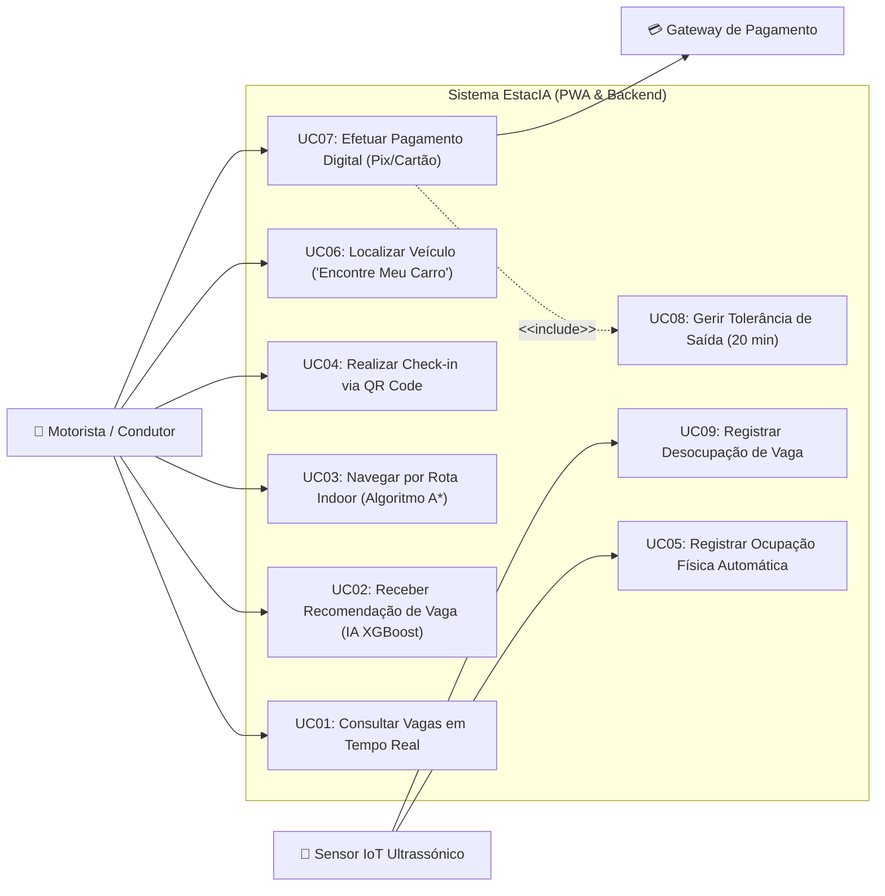

# Documentação do Diagrama de Casos de Uso — Sistema EstacIA

## 1. Visão Geral

Este documento descreve as interações, atores e funcionalidades do **Sistema EstacIA (PWA & Backend)** com base no Diagrama de Casos de Uso fornecido.
---

## 2. Diagrama em Código (Mermaid)

Você pode visualizar este diagrama em editores que suportam a sintaxe Mermaid (como GitHub, VS Code, Notion ou Obsidian):

---

## 3. Atores do Sistema

| Ator | Tipo | Descrição |
| :--- | :--- | :--- |
| **Motorista / Condutor** | Ator Principal (Usuário) | Usuário final do aplicativo PWA que interage com o sistema para buscar vagas, realizar check-in, pagar e navegar. |
| **Sensor IoT Ultrassónico** | Ator Secundário (Dispositivo) | Hardware físico instalado nas vagas que detecta a presença/ausência de veículos e envia dados ao backend. |
| **Gateway de Pagamento** | Ator Secundário (Sistema Externo) | Serviço externo encarregado de processar transações financeiras (Pix ou Cartão de Crédito/Débito). |

---

## 4. Detalhamento dos Casos de Uso

| Código | Caso de Uso | Ator Principal | Descrição |
| :--- | :--- | :--- | :--- |
| **UC01** | Consultar Vagas em Tempo Real | Motorista / Condutor | Permite visualizar a disponibilidade das vagas no estacionamento atualizada em tempo real. |
| **UC02** | Receber Recomendação de Vaga (IA XGBoost) | Motorista / Condutor | Sugere a melhor vaga disponível utilizando um modelo preditivo baseado em Machine Learning (XGBoost). |
| **UC03** | Navegar por Rota Indoor (Algoritmo A*) | Motorista / Condutor | Traça e exibe o melhor caminho até a vaga dentro do estacionamento utilizando o algoritmo de busca $A^*$. |
| **UC04** | Realizar Check-in via QR Code | Motorista / Condutor | Registra a entrada ou início da permanência no local escaneando um código QR. |
| **UC05** | Registrar Ocupação Física Automática | Sensor IoT Ultrassónico | Detecta a presença física de um carro na vaga e atualiza o estado no sistema. |
| **UC06** | Localizar Veículo ("Encontre Meu Carro") | Motorista / Condutor | Ajuda o condutor a encontrar a localização exata onde seu veículo ficou estacionado. |
| **UC07** | Efetuar Pagamento Digital (Pix/Cartão) | Motorista / Condutor | Processa a cobrança da permanência através da integração com o Gateway de Pagamento. |
| **UC08** | Gerir Tolerância de Saída (20 min) | Sistema (Incluso pelo UC07) | Valida e monitora a janela de tempo restante (20 minutos) para a saída do veículo após a quitação. |
| **UC09** | Registrar Desocupação de Vaga | Sensor IoT Ultrassónico | Identifica quando a vaga é liberada fisicamente e atualiza a disponibilidade no sistema. |

---

## 5. Relacionamentos Especiais

* **Inclusão (`<<include>>`):** 
  * O caso de uso **UC07 (Efetuar Pagamento Digital)** *inclui* obrigatoriamente o **UC08 (Gerir Tolerância de Saída)**. Isso significa que sempre que um pagamento for efetuado com sucesso, a contagem da tolerância de saída será disparada/gerenciada pelo sistema.
* **Integração Externa:**
  * O **UC07** depende diretamente da comunicação com o ator externo **Gateway de Pagamento**.
